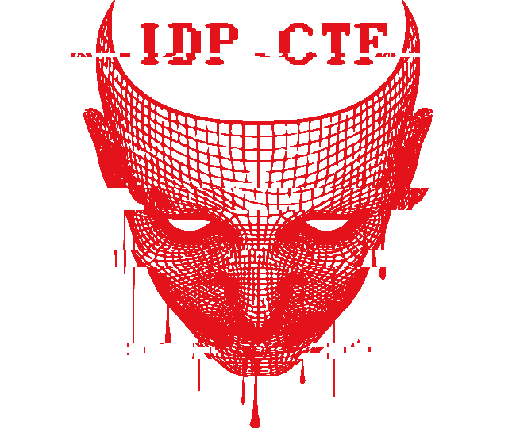

<b>🇧🇷 Português</b>

<h2>8º HACKATHON IDP — III CAPTURE THE FLAG</h2>

Writeups e artefatos dos desafios do <b>8º Hackathon IDP — III Capture The Flag 2026.2</b>, presencial no IDP Norte, Brasília.

  <b>Formato:</b> jeopardy + King of the Hill · pontuação dinâmica · flag <code>IDP{...}</code> 
  <b>Data:</b> 13/11/2026 18:00 → 14/11/2026 18:00, 24h contínuas (horário de Brasília) · <b>Encerrado</b> 
  <b>Regulamento:</b> <a href="docs/regulamento.md"><code>docs/regulamento.md</code></a>

<b>Resultado:</b> time <b>NOP</b> em <b>2º lugar</b> com <b>13813 pontos</b>, 53 de 54 desafios resolvidos, 12 first bloods e 2º lugar no King of the Hill (IDProc, 1640 pts).

As tabelas estão na seção em inglês abaixo. Todos os writeups seguem o <a href="WRITEUP_TEMPLATE.md"><code>WRITEUP_TEMPLATE.md</code></a>.

<h1>8TH HACKATHON IDP — III CAPTURE THE FLAG</h1>

Writeups and artifacts for the <b>8th IDP Hackathon — III Capture The Flag 2026.2</b>, on-site at IDP Norte, Brasília.

  <b>Format:</b> jeopardy + King of the Hill · dynamic scoring · flag <code>IDP{...}</code> 
  <b>Date:</b> November 13, 2026 18:00 → November 14, 2026 18:00, 24h non-stop (Brasília time) · <b>Finished</b>

<h2>Result</h2>
<table>
  <tr><th>Team</th><th>Rank</th><th>Score</th><th>Solved</th><th>First bloods</th><th>KotH</th></tr>
  <tr><td><b>NOP</b></td><td>🥈 2nd</td><td>13813</td><td>53 / 54</td><td>🩸 12</td><td>🥈 2nd · 1640</td></tr>
</table>
<table>
  <tr><th>#</th><th>Team</th><th>Score</th></tr>
  <tr><td>1</td><td>Névoa</td><td>13998</td></tr>
  <tr><td>2</td><td><b>NOP</b></td><td><b>13813</b></td></tr>
  <tr><td>3</td><td>Litrão por 9,90</td><td>13733</td></tr>
</table>
<table>
  <tr><th>Player</th><th>Specialty</th><th>Score</th></tr>
  <tr><td><a href="https://github.com/Felipebc2">Felipebc2</a></td><td>Reverse · Pwn</td><td>7214</td></tr>
  <tr><td><a href="https://github.com/Falizz">Falizz</a></td><td>—</td><td>2211</td></tr>
  <tr><td><a href="https://github.com/rafacandido7">rafacandido7</a></td><td>—</td><td>1948</td></tr>
  <tr><td><a href="https://github.com/LucasMMRocha">LucasMMRocha</a></td><td>—</td><td>1520</td></tr>
  <tr><td><a href="https://github.com/Guilherme0421">Guilherme0421</a></td><td>—</td><td>920</td></tr>
</table>

<h2>Challenges</h2>

Points are the final dynamic values. Status: ✅ solved · ❌ unsolved · 🩸 first blood. Difficulty: 🟢 easy · 🟡 medium · 🔴 hard · 🟣 insane. 
Linked challenges have a writeup; the others were solved by teammates and have no writeup here. 
³ exploit and flag by Felipebc2, submitted on the platform by a teammate.

<table>
  <tr><th>Challenge</th><th>Category</th><th>Diff</th><th>Pts</th><th>Status</th><th>Solved by</th></tr>
  <tr><td>Chaves em Série</td><td>Crypto</td><td>—</td><td>100</td><td>✅ 🩸</td><td>team</td></tr>
  <tr><td>Double Wordle</td><td>Crypto</td><td>—</td><td>100</td><td>✅</td><td>team</td></tr>
  <tr><td>Flag</td><td>Crypto</td><td>—</td><td>100</td><td>✅</td><td>team</td></tr>
  <tr><td>Manifesto Invisível</td><td>Crypto</td><td>—</td><td>100</td><td>✅</td><td>team</td></tr>
  <tr><td>Placa</td><td>Crypto</td><td>—</td><td>100</td><td>✅</td><td>team</td></tr>
  <tr><td>Interceptações Antigas</td><td>Crypto</td><td>—</td><td>259</td><td>✅ 🩸</td><td>team</td></tr>
  <tr><td><a href="Crypto/Loja/">Loja</a></td><td>Crypto</td><td>🟡</td><td>259</td><td>✅</td><td><a href="https://github.com/Felipebc2">Felipebc2</a></td></tr>
  <tr><td><a href="Crypto/Sorteio/">Sorteio</a></td><td>Crypto</td><td>🟡</td><td>323</td><td>✅</td><td><a href="https://github.com/Felipebc2">Felipebc2</a></td></tr>
  <tr><td><a href="JAIL/BabySSH/">Baby SSH</a></td><td>Jail</td><td>🟢</td><td>184</td><td>✅</td><td><a href="https://github.com/Felipebc2">Felipebc2</a></td></tr>
  <tr><td>Pycomjail</td><td>Jail</td><td>—</td><td>184</td><td>✅</td><td>team</td></tr>
  <tr><td><a href="JAIL/Pysemjail/">Pysemjail</a></td><td>Jail</td><td>🟢</td><td>184</td><td>✅</td><td><a href="https://github.com/Felipebc2">Felipebc2</a></td></tr>
  <tr><td><a href="KOTH/IDProc/">IDProc</a></td><td>KotH</td><td>—</td><td>1640</td><td>🏁 2nd</td><td>team</td></tr>
  <tr><td>Campfire</td><td>Misc</td><td>—</td><td>100</td><td>✅ 🩸</td><td>team</td></tr>
  <tr><td>Lockpicking</td><td>Misc</td><td>—</td><td>184</td><td>✅</td><td>team</td></tr>
  <tr><td>Luigi Tower</td><td>Misc</td><td>—</td><td>184</td><td>✅</td><td>team</td></tr>
  <tr><td>Mario Tower</td><td>Misc</td><td>—</td><td>184</td><td>✅</td><td>team</td></tr>
  <tr><td>Super Mario Wall</td><td>Misc</td><td>—</td><td>323</td><td>✅</td><td>team</td></tr>
  <tr><td>Assalto</td><td>Misc</td><td>—</td><td>377</td><td>✅ 🩸</td><td>team</td></tr>
  <tr><td>Fuga</td><td>Misc</td><td>—</td><td>377</td><td>✅</td><td><a href="https://github.com/Felipebc2">Felipebc2</a></td></tr>
  <tr><td><a href="NET/Analise/">Análise</a></td><td>NET</td><td>🟡</td><td>100</td><td>✅</td><td><a href="https://github.com/Felipebc2">Felipebc2</a></td></tr>
  <tr><td>Comprovante</td><td>NET</td><td>—</td><td>100</td><td>✅</td><td>team</td></tr>
  <tr><td><a href="NET/Nomes/">Nomes</a></td><td>NET</td><td>🟢</td><td>184</td><td>✅</td><td><a href="https://github.com/Felipebc2">Felipebc2</a></td></tr>
  <tr><td>Telemetria</td><td>NET</td><td>—</td><td>184</td><td>✅ 🩸</td><td>team</td></tr>
  <tr><td><a href="NET/Helpdesk/">Helpdesk</a></td><td>NET</td><td>🟡</td><td>323</td><td>✅</td><td><a href="https://github.com/Felipebc2">Felipebc2</a></td></tr>
  <tr><td>Bem-vindo</td><td>OSINT</td><td>—</td><td>100</td><td>✅</td><td>team</td></tr>
  <tr><td>Newsletter</td><td>OSINT</td><td>—</td><td>184</td><td>✅</td><td><a href="https://github.com/Felipebc2">Felipebc2</a></td></tr>
  <tr><td>Apresentação</td><td>OSINT</td><td>—</td><td>259</td><td>✅</td><td>team</td></tr>
  <tr><td><a href="OSINT/Correio/">Correio</a></td><td>OSINT</td><td>🟡</td><td>259</td><td>✅</td><td><a href="https://github.com/Felipebc2">Felipebc2</a></td></tr>
  <tr><td>Grupo</td><td>OSINT</td><td>—</td><td>259</td><td>✅</td><td>team</td></tr>
  <tr><td>Propaganda</td><td>OSINT</td><td>—</td><td>323</td><td>✅</td><td>team</td></tr>
  <tr><td>Hackathon</td><td>OSINT</td><td>—</td><td>377</td><td>✅ 🩸</td><td>team</td></tr>
  <tr><td>Trimos</td><td>PPC</td><td>—</td><td>100</td><td>✅ 🩸</td><td>team</td></tr>
  <tr><td>PC Lento</td><td>PPC</td><td>—</td><td>259</td><td>✅ 🩸</td><td>team</td></tr>
  <tr><td>Trie Harder</td><td>PPC</td><td>—</td><td>323</td><td>✅</td><td>team</td></tr>
  <tr><td>Conhecimento Global</td><td>Pwn</td><td>—</td><td>100</td><td>✅</td><td>team</td></tr>
  <tr><td><a href="Pwn/TwitchPwn01/">Twitch Pwn 01</a></td><td>Pwn</td><td>🟡</td><td>184</td><td>✅ 🩸</td><td><a href="https://github.com/Felipebc2">Felipebc2</a></td></tr>
  <tr><td><a href="Pwn/TwitchPwn02/">Twitch Pwn 02</a></td><td>Pwn</td><td>🔴</td><td>259</td><td>✅ 🩸</td><td><a href="https://github.com/Felipebc2">Felipebc2</a></td></tr>
  <tr><td><a href="Pwn/Cadeado/">Cadeado</a></td><td>Pwn</td><td>🟡</td><td>323</td><td>✅</td><td>team</td></tr>
  <tr><td><a href="Pwn/TwitchPwn03/">Twitch Pwn 03</a></td><td>Pwn</td><td>🔴</td><td>377</td><td>✅</td><td><a href="https://github.com/Felipebc2">Felipebc2</a>³</td></tr>
  <tr><td><a href="Pwn/TwitchPwn04/">Twitch Pwn 04</a></td><td>Pwn</td><td>🔴</td><td>421</td><td>✅</td><td><a href="https://github.com/Felipebc2">Felipebc2</a></td></tr>
  <tr><td><a href="Rev/Legibilidade/">Legibilidade</a></td><td>Rev</td><td>🟢</td><td>100</td><td>✅ 🩸</td><td><a href="https://github.com/Felipebc2">Felipebc2</a></td></tr>
  <tr><td><a href="Rev/Zoom/">Zoom</a></td><td>Rev</td><td>🟢</td><td>184</td><td>✅</td><td><a href="https://github.com/Felipebc2">Felipebc2</a></td></tr>
  <tr><td><a href="Rev/Cofre/">Cofre</a></td><td>Rev</td><td>🔴</td><td>259</td><td>✅</td><td><a href="https://github.com/Felipebc2">Felipebc2</a></td></tr>
  <tr><td><a href="Rev/Inclinacao/">Inclinação</a></td><td>Rev</td><td>🟡</td><td>377</td><td>✅ 🩸</td><td><a href="https://github.com/Felipebc2">Felipebc2</a></td></tr>
  <tr><td>Remoeval</td><td>Web</td><td>—</td><td>184</td><td>✅</td><td>team</td></tr>
  <tr><td><a href="Web/Dualidade/">Dualidade</a></td><td>Web</td><td>🔴</td><td>259</td><td>✅</td><td>team</td></tr>
  <tr><td><a href="Web/EscritaAMao/">Escrita à mão</a></td><td>Web</td><td>🟡</td><td>259</td><td>✅</td><td><a href="https://github.com/Felipebc2">Felipebc2</a></td></tr>
  <tr><td>IDPCast</td><td>Web</td><td>—</td><td>259</td><td>✅</td><td>team</td></tr>
  <tr><td>Long Robots</td><td>Web</td><td>—</td><td>259</td><td>✅</td><td>team</td></tr>
  <tr><td><a href="Web/PartyInBSB/">Party in BSB</a></td><td>Web</td><td>🔴</td><td>259</td><td>✅</td><td><a href="https://github.com/Felipebc2">Felipebc2</a></td></tr>
  <tr><td><a href="Web/UmaIdeiaParaOIdea/">Uma Ideia para o IDEA</a></td><td>Web</td><td>🔴</td><td>259</td><td>✅</td><td>team</td></tr>
  <tr><td><a href="Web/UniDP/">UniDP</a></td><td>Web</td><td>🔴</td><td>259</td><td>✅</td><td><a href="https://github.com/Felipebc2">Felipebc2</a></td></tr>
  <tr><td><a href="Web/WAForte/">WAForte</a></td><td>Web</td><td>🔴</td><td>259</td><td>✅</td><td><a href="https://github.com/Felipebc2">Felipebc2</a></td></tr>
  <tr><td><a href="Web/CentralDeChamados/">Central de Chamados</a></td><td>Web</td><td>🔴</td><td>377</td><td>✅</td><td><a href="https://github.com/Felipebc2">Felipebc2</a></td></tr>
  <tr><td><a href="Web/MyLittlePlone/">My Little Plone</a></td><td>Web</td><td>🔴</td><td>500</td><td>❌</td><td>—</td></tr>
</table>

